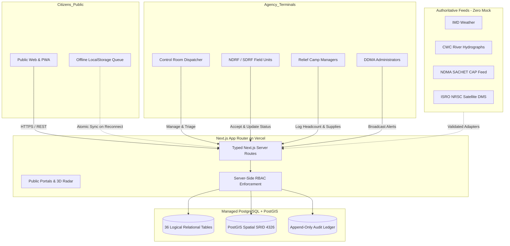

# NE-RESQ Architecture Specification

## 1. System Topology

NE-RESQ is designed around a decoupled, resilient architecture connecting citizens, district control rooms, field rescue teams, and relief managers across all eight Northeast Indian states.

## 2. Trust Boundaries & Roles

1. **Public Zone**: Public pages, disaster preparedness guides, official alerts, verified shelters, and emergency SOS submission without requiring registration.
2. **Citizen Zone**: Authenticated citizens viewing personal SOS tracking and past submissions.
3. **Operational Zone**: Control room dispatchers triaging requests, assigning rescue units, and logging status history.
4. **Field Tactical Zone**: NDRF/SDRF units accepting missions, updating status, and reporting completions.
5. **Administrative Zone**: State and District disaster managers managing facility verification, broadcasting official warnings, and reviewing crowd reports.
